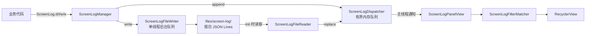
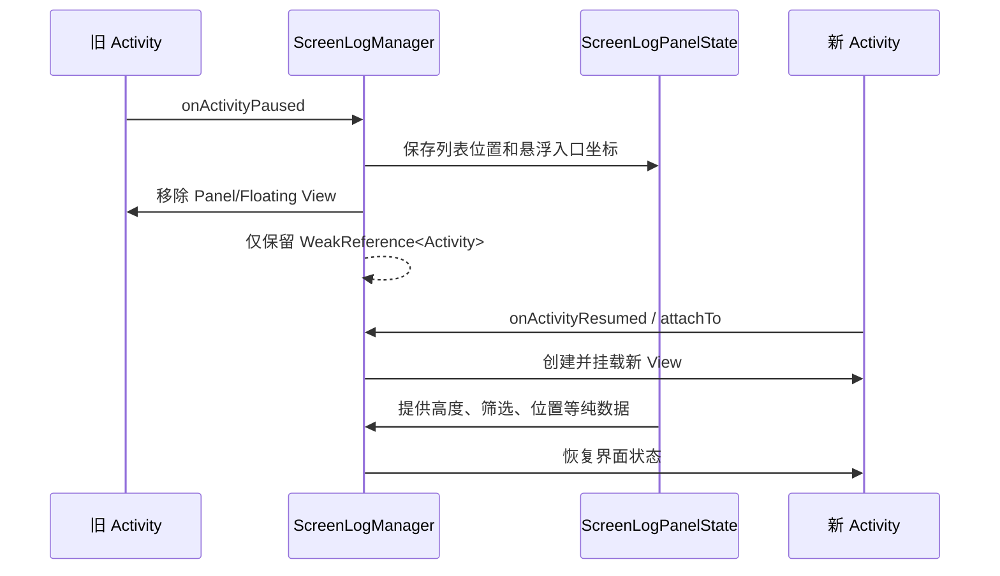

# Screen Log 架构与实现方案

本文面向方案评审，描述 `screen-log` 当前实现、关键设计选择、运行时行为、风险和待决策项。接入操作见 [README.md](./README.md)，真机自测优化项见 [SELF_TEST_TODO.md](./SELF_TEST_TODO.md)。

## 1. 目标与边界

### 设计目标

- 提供独立、低接入成本的 App 内业务日志查看能力。
- 不依赖 Compose，不侵入业务页面布局。
- 支持内存展示、按日持久化、搜索筛选、复制和自动滚动控制。
- 在 Activity 切换时延续用户正在查看的 UI 状态。
- 避免单例强持有 Activity，降低页面泄漏风险。

### 非目标

- 不替代 `logcat` 或完整日志平台。
- 不自动采集系统、网络或第三方 SDK 日志。
- 不负责上传、分享、加密和脱敏。
- 不恢复跨进程的临时筛选、列表位置和多选状态。
- 当前不面向多窗口并行展示。

## 2. 模块结构

```text
screen-log/
├── api/       对接入方公开的配置、日志写入和 UI 控制入口
├── core/      日志数据模型、格式化、内存队列和监听分发
├── storage/   按日文件读写、容量限制和历史清理
├── filter/    与 Android UI 无关的筛选模型和匹配逻辑
├── ui/        悬浮入口、菜单、日志面板、设置页和 UI 状态
└── res/       View/XML 布局、颜色、样式和字符串资源
```

| 分层 | 核心类型 | 职责 |
| --- | --- | --- |
| API | `ScreenLog` | 提供 `v/d/i/w/e` 业务写入入口 |
| API | `ScreenLogConfig` | 定义总开关、持久化、保留期、等级和容量 |
| API | `ScreenLogManager` | 模块编排、Activity 生命周期、View 挂载和公开控制 API |
| Core | `ScreenLogEntry` | 单条日志的数据模型 |
| Core | `ScreenLogDispatcher` | 有界内存日志、监听通知、自动滚动状态 |
| Core | `ScreenLogPreferences` | 集中读写用户可配置偏好及默认值 |
| Core | `ScreenLogFormatter` | 展示文本与 JSON Lines 序列化 |
| Storage | `ScreenLogFileWriter` | 单线程异步写文件和单日容量限制 |
| Storage | `ScreenLogFileReader` | 启动时读取近期日志 |
| Storage | `ScreenLogCleaner` | 按文件日期清理过期日志 |
| Filter | `ScreenLogFilterMatcher` | 等级、Tag、关键字组合筛选 |
| UI | `ScreenLogFloatingView` | 可拖动悬浮入口与菜单容器 |
| UI | `ScreenLogPanelView` | 列表、筛选、复制、双击变高和触摸模式 |
| UI | `ScreenLogPanelState` | Activity 切换间共享的纯数据 UI 状态 |

## 3. 总体数据流



日志写入路径有意拆为两条：内存路径立即服务 UI，文件路径在后台串行执行。文件写入慢或关闭持久化时，不影响当前进程内的日志查看。

## 4. 初始化与日志写入

### 初始化

`ScreenLogManager.init(config)` 依次执行：

1. 保存配置；`enable=false` 时移除现有 UI、清理宿主引用并直接返回。
2. `enable=true` 时从模块私有 `SharedPreferences` 恢复记录、自动滚动、触摸、复制和布局偏好；无已保存值时使用默认配置。
3. 清理超出 `keepDays` 的历史文件。
4. 配置内存日志上限。
5. 读取近期日志文件并恢复到内存。
6. 初始化后台文件写入器。
7. 首次启用时注册 `ActivityLifecycleCallbacks`。

`AtomicBoolean` 保证生命周期回调只注册一次。重复调用 `init()` 会更新配置、内存容量和文件写入器，但不会重复注册回调。

### 写入

`ScreenLog` 将调用委托给 `ScreenLogManager.write()`：

1. 检查是否初始化、是否启用以及最低等级。
2. 检查运行时“记录日志”状态；关闭时直接忽略新日志。
3. 将异常堆栈拼接到 message。
4. 创建不可变 `ScreenLogEntry`。
5. 同步追加到受锁保护的内存列表。
6. 提交到单线程文件队列。

`ScreenLogDispatcher` 超出容量时批量删除最早记录；对 UI 提供快照，避免列表直接持有内部可变集合。

## 5. UI 挂载与 Activity 生命周期

悬浮入口和面板是普通 App 内 View，挂载到当前 Activity 的 `android.R.id.content`。它们不是系统悬浮窗，因此不需要悬浮窗权限。



### Activity 引用策略

`ScreenLogManager` 是进程级单例，但只通过 `WeakReference<Activity>` 记录当前宿主。使用前检查 `isFinishing` 和 `isDestroyed`，并在 Activity 销毁时清除对应引用。

View 本身会持有创建它的 Activity Context，因此在 `onActivityPaused` 时主动从父容器移除并置空 `floatingView`、`panelView`。这是防止旧页面因 View 链被单例间接持有的关键步骤。

### 跨 Activity UI 状态

`ScreenLogPanelState` 只保存纯数据：

- 面板是否为 `2/3` 高度。
- 关键字、Tag、等级筛选。
- 首个可见列表位置和像素偏移。
- 悬浮入口 X/Y 坐标。

状态不包含 `Activity`、`View`、`Adapter` 或 `LayoutManager`，因此不会反向持有旧页面。筛选条件和列表位置与应用进程同生命周期；面板高度、悬浮入口坐标等用户偏好通过 `ScreenLogPreferences` 跨进程恢复。

## 6. 面板实现

`ScreenLogPanelView` 使用 `ConstraintLayout + RecyclerView`：

- 顶部操作区：标题、复制、清空、设置；长按日志后切换为多选操作区。
- 筛选区：关键字、等级、Tag、暂停/恢复滚动。
- 内容区：RecyclerView 日志列表。

日志变化通知会延迟约 180ms 合并刷新，降低高频日志下的 UI 更新次数。Adapter 使用 `ListAdapter + DiffUtil` 在后台计算差异，只更新新增、删除或变化的条目；diff 提交完成后再恢复滚动位置或跟随最新日志。

长按日志进入多选模式，选中状态按日志对象维护；多选期间筛选条件锁定并暂停自动滚动，退出后恢复原状态。“全选”仅作用于当前筛选结果。复制展示格式与剪贴板格式分离，剪贴板默认只输出 message，可通过 `ScreenLogCopyOptions` 增加时间、等级、Tag、线程名和 extras。单条日志启用 `prettyJson` 后，JSON Object 或 JSON Array 类型的 message 会在展示和复制时以两空格缩进，原始 message 仍用于搜索和文件持久化。

### 高度切换

面板默认高度为屏幕 `1/3`，双击后设置为 `2/3`。手势检测位于面板的 `dispatchTouchEvent()`，同时保留子 View 的滚动和长按事件处理。

### 自动滚动

自动滚动状态保存在 `ScreenLogDispatcher`：

- 未暂停：刷新后滚动到最后一条。
- 已暂停：保留用户当前位置，但日志仍继续进入内存和文件。
- Activity 切换：记录首个可见位置和偏移并在新 View 中恢复。

### 运行时记录控制

`ScreenLogConfig.enable` 是最高优先级总开关。只有 `enable=true` 时，运行时“记录日志”Switch 才能改变记录状态。

- 默认开启：新日志同时进入内存和文件队列。
- 手动关闭：保留已有日志和 UI，后续 `ScreenLog.*` 调用在创建日志条目前被忽略。
- 再次开启：从开启时刻继续追加。
- 状态在 Activity 切换间保持，并在进程重新初始化时恢复上次用户选择。

### 触摸模式

- `LOG_PANEL`：面板参与事件分发，允许滚动、输入、复制和双击。
- `UNDERLYING_PAGE`：面板的 `dispatchTouchEvent()` 返回 `false`，目标是允许操作下层页面。

该透传方案依赖 Android 当前 View 层级的事件分发行为，需要在目标宿主中做一次真机交互验收。

建议在面板覆盖区域下放置 Button、RecyclerView/ScrollView、EditText、横向滑动控件和长按控件，验证：

1. `UNDERLYING_PAGE` 下按钮点击、列表滚动、输入框聚焦、横滑和长按均由业务页面响应。
2. `UNDERLYING_PAGE` 下日志面板自身不响应滚动、筛选或双击扩展。
3. 切回 `LOG_PANEL` 后，面板操作恢复，覆盖区域内的事件不再交给业务页面。
4. 切换 Activity 后触摸模式保持一致。
5. 目标工程包含 WebView、ViewPager、地图或 Dialog 时，对这些复杂容器单独复测。

## 7. 存储方案

### 路径和格式

```text
<app files dir>/screen-log/screen_log_yyyy-MM-dd.log
```

文件采用 JSON Lines，每行独立反序列化。单行损坏时读取器会跳过该行，不影响其他日志。

```json
{"timeMillis":1710000000000,"level":"INFO","tag":"Login","message":"success","threadName":"main","extras":{"userType":"guest"}}
```

### 保留和限流

- 初始化时按文件名日期清理过期文件。
- 读取按文件名排序后取最近 `keepDays` 个日志文件。
- 单日文件达到 `maxFileSizeMb` 后停止当天后续落盘。
- 文件操作由单线程 `ExecutorService` 串行执行，避免并发写入破坏行结构。

### 一致性边界

- 内存追加先于文件写入，因此应用异常退出时，队列末尾日志可能尚未落盘。
- `clearLogs()` 立即清内存，文件删除异步执行，极短时间内文件仍可能存在。
- 当前没有 flush、关闭或写入失败回调。

## 8. 线程模型

| 操作 | 线程策略 |
| --- | --- |
| 业务调用 `ScreenLog.*` | 允许任意线程 |
| 内存列表读写 | `synchronized(entries)` |
| UI 监听通知 | `Handler(Looper.getMainLooper())` |
| View 挂载和公开 UI 控制 | `runOnMain` 切主线程 |
| 文件写入/清空 | 单线程 Executor |
| 格式化日期 | `ThreadLocal<SimpleDateFormat>` |

监听器使用 `CopyOnWriteArrayList`，适合监听器数量少、通知频率高于增删频率的场景。

## 9. 公开接口与封装边界

对接入方稳定暴露：

- `ScreenLog`
- `ScreenLogConfig`
- `ScreenLogLevel`
- `ScreenLogTouchMode`
- `ScreenLogManager` 的 public 方法

UI View 和 `ScreenLogPanelState` 为模块内部实现，不应由业务代码直接创建或持有。`core`、`storage`、`filter` 当前在源码层部分类型仍为 public，但方案上不建议作为接入 API 使用；后续发布二进制 SDK 前可进一步收紧可见性。

## 10. 使用边界

组件定位为内部调试工具，日志文件位于 App 私有目录。根据当前使用范围，模块不提供加密、脱敏、上传或访问审计能力，这些能力不作为本方案的交付项。

如未来扩大到外部用户、增加导出或上传能力，需要重新评审访问控制、留存和数据安全方案。

## 11. 当前优势

- 模块独立，业务只依赖公开 API。
- 无系统权限，无 Compose 依赖。
- 内存与文件双通道，文件 IO 不阻塞业务线程。
- Activity 使用弱引用，View 在页面暂停时主动解绑。
- UI 状态与 View 解耦，页面切换体验连续。
- 日志格式按行独立，局部损坏可容忍。

## 12. 已确认方案

- `enable` 已作为统一总开关，关闭后写入和显示 API 均不生效。
- `enable=true` 时支持运行时开始/停止记录；停止记录不会清空已有日志。
- 组件以显示交互为主，当前采用真机交互验收，不要求自动化测试。
- 组件仅供内部使用，不提供脱敏和加密。
- 普通 Activity 自动参与挂载；设置页不挂载悬浮入口和日志面板，避免浮层遮挡设置交互。
- 列表使用 `ListAdapter + DiffUtil`，避免每次刷新全量重绑可见条目。
- 状态型操作使用中文 Switch；触摸目标使用“日志面板/下层页面”分段选择。

## 13. 已知限制与后续建议

| 优先级 | 风险/限制 | 建议 |
| --- | --- | --- |
| 中 | `UNDERLYING_PAGE` 的触摸透传依赖具体 View 层级 | 在目标宿主工程做触摸矩阵验证，必要时改为更明确的覆盖层方案 |
| 中 | 无文件写入错误回调和 flush | 增加错误观测、队列状态和可选 flush API |
| 低 | UI 文案部分硬编码英文 | 迁移到 string resource，并补国际化 |
| 低 | 诊断用触摸日志较多 | 功能稳定后用调试开关控制或移除 |
| 低 | 悬浮入口坐标按像素保存 | 恢复时按当前屏幕范围约束，后续可按需改为归一化坐标 |

## 14. 方案评审决策点

建议评审会上明确以下事项：

1. Release 包是否允许包含该模块，启用条件和入口权限如何控制。
2. 是否接受“业务主动写入、组件不自动采集”的职责边界。
3. 是否要求日志导出/分享；若要求，需要补充对应方案。
4. `UNDERLYING_PAGE` 的目标业务页面和触摸验收范围。
5. 是否要求进程重启后恢复筛选和位置。
6. 性能目标：最大日志速率、内存条数、文件容量和低端设备指标。

## 15. 建议验收指标

- 连续写入 2000 条日志时主线程无明显卡顿或 ANR。
- 内存条数始终不超过配置上限。
- 高频日志下 UI 刷新节流生效，滚动和筛选可操作。
- Activity 连续切换后无旧 Activity 泄漏，状态恢复正确。
- 旋转、前后台切换和设置页跳转后 View 不重复挂载。
- 文件达到上限、磁盘写入失败或单行损坏时应用不崩溃。
- Release 关闭开关且不调用显示 API 时，不显示入口、不保留新日志。
